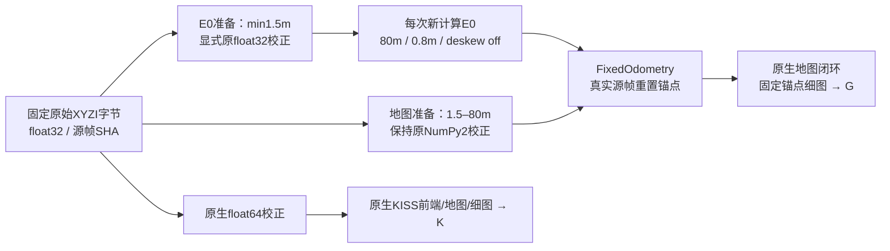

# 输入数值契约：前端与地图分支分别保持

相同源码/包版本/配置不等于相同数值输入。已观测的原校正表达式在NumPy1.26.4中使用float32中间乘法/和，在2.2.6中使用float64。输出数组最终都是float32，仍有舍入差异。固定合成例9992/30009分量不同；这不是所有NumPy运算的结论，也不能单凭它唯一归因真实轨迹差异。

新的显式float32函数对全部12296个原始输入逐帧核对通过：1514179545个准备点、4542538635个坐标分量的计数/顺序及准备缓冲SHA与原RAP环境一致。原R0最大位姿矩阵元素差0.5583的失败保留；恢复这个输入契约后，00前端在同一KISS环境中的对应差为5.73e-11。其余序列与重复仍需各自通过原1e-5条件，不能靠单条正例自动推断。

显式float32仅用于复现原E0前端输入。地图分支保持旧G NumPy2字节语义；K保持原生C++读取/校正。把三个分支一概替换成同一校正，会改变已声明的实验构造。E0源姿态参考是接口对照，不是真值，也不作为新前端输入；每个真实G单元必须重新运行注册。

input_precision_component包只含原合成点、原RAP校正结果、固定函数、两个版本的观察、字节核对摘要与可独立运行的fixture检查，不含真实扫描/真值坐标或新模型。支持范围是这两个已验证的运行时/数据角色，未来版本应重新核对；该组件不证明ICP后端跨ABI等价、完整系统精度或RAP增量。
