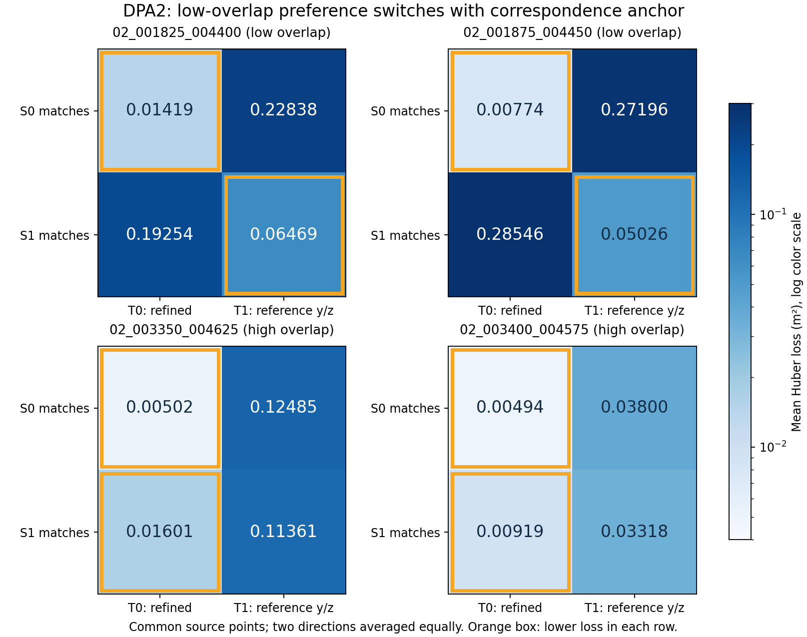

# DPA2双锚定诊断与下一优化决策

2026-11-10，Asia/Shanghai。用户本轮授权继续决策和执行、更新交接并一次提交。DPA2已关闭；研究 **UNRESOLVED**、论文 **PAUSED**，无新准确率或方法晋升。

## 决策与证据

低重叠事件的DPA1损失偏好依赖对应支持锚点。两低对在前/反方向、完整支持/共同源点两种总体上均是S0偏T0、S1偏T1；没有建立跨支持一致的末态偏好证据。高重叠两对则在全部这些表上都偏T0，需将其作为另一个目标/参考一致性待查问题，不能用来证明低事件的物理根因。

下一优化优先为**共同几何支持的可用性与约束诊断**，先核对无需参考的互惠对应、源/目标法线兼容与y/z投影约束分布。若缺少足够且方向充分的共同支持，则应研究低重叠几何的结构约束或弃权条件，不能靠继续同一ICP或调旧接纳阈值创造正确候选。该诊断仍不认证物理静态/可观测性/安全性，具体下一合同见NEXT_SUPPORT_CONTRACT.md，仅草案未执行。

低对共同源点对应索引改变99.986%–100%，两个锚的目标法线绝对夹角中位数43.06°–55.70°；高对改变58.54%–63.39%，但中位法线夹角仅.715°–1.568°。因此“索引改变”本身也不能等同换了物理表面，下一步需检查支持结构，而不只计数。法线差异来自本次处理与邻域估计，不证明场景运动。

两低对属于02_12_29一个事件，两高对属于02_22_30一个事件，均已开发暴露；四对不是四个独立确认。T1使用记录参考y/z，不是GT-free候选。T0并未因此获得物理正确认证。

## 执行与验证

复用DPA1-v2四个NPZ字节相同副本，共8,041,553字节。0原始扫描读取、0重采样/法线计算；两端点每方向一次，共16次静态NN查询。距离门限.75m，Huber delta=.5、同支持取均值，严格逆矩阵。末态与参考y/z端点和DPA1逐项匹配。

实测墙钟1.812秒，worker峰值RSS约71.6MiB，监督进程约11.2MiB，结果3,869,438字节。CPU单线程/CUDA不可见；硬AS≤2GiB−64MiB、CPU55秒/墙钟60秒、输出≤8MiB。无模型、ICP、RANSAC、优化更新、旧评分器/选择器或训练。

8项合成检查与超时/超额内存/单文件/总输出四类监督负例均按预期通过。本轮无意外运行失败；预期MemoryError/Errno27/终止日志保留。独立程序重算64项损失（绝对差≤1e-12）、16组保存的索引点对距离，并核对DPA1端点、源交并和法线角度。独立验证0额外NN、0原raw读取；没有对真实云再做穷举最近点搜索，最近点实现仅在合成小例作穷举核验。

## 共同源点上的交叉目标表

图中每一行保持同一组源点与同一锚点的目标对应；换行改变对应。两方向各取均值后等权平均。橙框只表示该行数值较低，不表示正确姿态。

下表列出全部64项方向损失。每行包含两个姿态的读数，单位m²；不同支持均值不作同总体比较。

| 配对 | 方向 | 总体 | 对应锚 | L(T0) | L(T1) | 偏好 |
| --- | --- | --- | --- | ---: | ---: | --- |
| 02_001825_004400 | forward | 完整 | S0 | 0.01154035 | 0.29031026 | T0 |
| 02_001825_004400 | forward | 完整 | S1 | 0.18967320 | 0.06168807 | T1 |
| 02_001825_004400 | forward | 交集 | S0 | 0.01444469 | 0.23760783 | T0 |
| 02_001825_004400 | forward | 交集 | S1 | 0.17804098 | 0.06308925 | T1 |
| 02_001825_004400 | reverse | 完整 | S0 | 0.01345509 | 0.30847991 | T0 |
| 02_001825_004400 | reverse | 完整 | S1 | 0.20699181 | 0.06553885 | T1 |
| 02_001825_004400 | reverse | 交集 | S0 | 0.01394251 | 0.21915480 | T0 |
| 02_001825_004400 | reverse | 交集 | S1 | 0.20703371 | 0.06629848 | T1 |
| 02_001875_004450 | forward | 完整 | S0 | 0.00694023 | 0.38856996 | T0 |
| 02_001875_004450 | forward | 完整 | S1 | 0.23412385 | 0.04832418 | T1 |
| 02_001875_004450 | forward | 交集 | S0 | 0.00476917 | 0.30204145 | T0 |
| 02_001875_004450 | forward | 交集 | S1 | 0.23256551 | 0.04850547 | T1 |
| 02_001875_004450 | reverse | 完整 | S0 | 0.00787925 | 0.39918965 | T0 |
| 02_001875_004450 | reverse | 完整 | S1 | 0.34111566 | 0.05285059 | T1 |
| 02_001875_004450 | reverse | 交集 | S0 | 0.01071295 | 0.24187747 | T0 |
| 02_001875_004450 | reverse | 交集 | S1 | 0.33835538 | 0.05202405 | T1 |
| 02_003350_004625 | forward | 完整 | S0 | 0.00577050 | 0.13439531 | T0 |
| 02_003350_004625 | forward | 完整 | S1 | 0.01975744 | 0.11031915 | T0 |
| 02_003350_004625 | forward | 交集 | S0 | 0.00410493 | 0.12589265 | T0 |
| 02_003350_004625 | forward | 交集 | S1 | 0.01824254 | 0.11068935 | T0 |
| 02_003350_004625 | reverse | 完整 | S0 | 0.00693029 | 0.13044424 | T0 |
| 02_003350_004625 | reverse | 完整 | S1 | 0.01528977 | 0.11605404 | T0 |
| 02_003350_004625 | reverse | 交集 | S0 | 0.00593193 | 0.12380772 | T0 |
| 02_003350_004625 | reverse | 交集 | S1 | 0.01377748 | 0.11653976 | T0 |
| 02_003400_004575 | forward | 完整 | S0 | 0.00519996 | 0.04206238 | T0 |
| 02_003400_004575 | forward | 完整 | S1 | 0.00920901 | 0.03449906 | T0 |
| 02_003400_004575 | forward | 交集 | S0 | 0.00406737 | 0.03944467 | T0 |
| 02_003400_004575 | forward | 交集 | S1 | 0.00866904 | 0.03430083 | T0 |
| 02_003400_004575 | reverse | 完整 | S0 | 0.00647214 | 0.03795618 | T0 |
| 02_003400_004575 | reverse | 完整 | S1 | 0.01093687 | 0.03241170 | T0 |
| 02_003400_004575 | reverse | 交集 | S0 | 0.00581084 | 0.03654941 | T0 |
| 02_003400_004575 | reverse | 交集 | S1 | 0.00970964 | 0.03206206 | T0 |

## 支持交并与法线变化

| 配对 | 方向 | S0/S1数 | 交集 | 交并比 | 索引改变 | 法线夹角中位数 |
| --- | --- | --- | ---: | ---: | ---: | ---: |
| 02_001825_004400 | forward | 16921/7785 | 7236 | 0.4142 | 99.986% | 49.848° |
| 02_001825_004400 | reverse | 17408/7119 | 6633 | 0.3707 | 100.000% | 55.700° |
| 02_001875_004450 | forward | 17962/7983 | 7875 | 0.4358 | 100.000% | 44.317° |
| 02_001875_004450 | reverse | 17146/6130 | 5884 | 0.3383 | 100.000% | 43.063° |
| 02_003350_004625 | forward | 23483/20889 | 20731 | 0.8769 | 61.816% | 1.243° |
| 02_003350_004625 | reverse | 23751/21467 | 21300 | 0.8905 | 58.540% | 0.715° |
| 02_003400_004575 | forward | 25953/25381 | 25317 | 0.9731 | 63.392% | 1.561° |
| 02_003400_004575 | reverse | 27414/27204 | 26996 | 0.9773 | 62.691% | 1.568° |

## 边界和保全

本实验只证实上述固定处理/端点/对应支持的数值行为，不区分扫描处理、场景动态、法线与记录参考误差，不证明局部/全局最优或参考错误。原0.205°修正、原始文件是否先行加工、KITTI来源/参考物理精度继续未知。03开发暴露与训练未准入、SSC1/PGC1停止及七份部分准确率未解释读取、official MAC未运行保持。

旧结果、seal/freeze、失败均未改。22生产代码/配置/依赖文件原字节保持，无生产算法变化。当前入口替换前8份备份位于before/；本轮仅一次聚焦RAP-main提交，新增源/输入/结果/报告/交接快照纳入，已有生产修改和另一仓库未提交修改保留，不推送。提交后收据另存本地交接和远端版本目录，避免为写入自身hash再提交一次。

本阶段主要文件：cross_anchor.py、supervise.py、verify_cross.py、PROTOCOL_CN.md、INPUTS/freeze、inputs/、results/、INDEPENDENT_CHECKS.json、CROSS_TABLES.csv、图、HANDOFF_CN.md、CLOSEOUT_CHECKS.json和ARTIFACT_MANIFEST.json。父实验副本在parent/，它的历史绝对路径仅作来源记录；本阶段计算脚本使用本目录相对路径。
