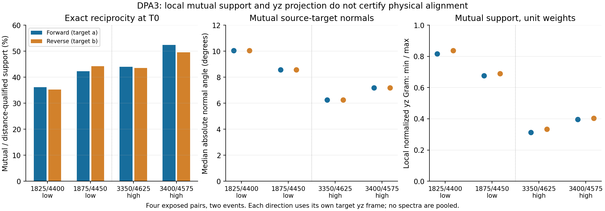

# DPA3原末态支持诊断与优化决策

2026-11-10，Asia/Shanghai。用户本轮授权继续决策与执行、更新交接和一次提交。DPA3已完成并关闭；研究 **UNRESOLVED**，论文 **PAUSED**；无新方法/准确率晋升。

## 结论与决策

低重叠两对在原rap_raw细化末态分别有6129、7592个精确互惠点对，分别占原距离支持的35.2%–36.2%与42.3%–44.3%。互惠源/目标法线中位绝对夹角约10.06°和8.58°。在各自目标坐标的互惠单位权重y/z归一化Gram中，低对λmin约.385–.423、λmin/λmax约.677–.837；这些固定支持统计没有表现为y/z某一个投影方向接近零。高对对应比值约.312–.403，不能把比值更高解释为低对物理信息更强或更正确。

因此，**不把增加同一局部ICP迭代、补单一y/z弱轴或改旧验收阈值作为下一默认优化**。DPA2已显示低事件偏好随对应锚切换，DPA3又说明错误风险可以伴随数千互惠、法线较一致且投影谱非退化的局部对应。仅靠互惠/法线一致/局部谱不能认证结构身份。这与旧SAC1局部满秩仍有别名风险的边界一致，但本轮未重跑旧路线。

下一策略转为**结构关联歧义的受控可辨识性与弃权验证**：先用具有已知物理点身份的受控重复/非重复结构，检验“局部支持丰富但错误别名成立”的反例，以及新增独立结构锚点在可见时是否真的区分候选。完全等价的重复结构必须保留歧义；不能为达到记录1m阈值挑选姿态。下一合同DPA4仅草案，本轮未执行。当前没有足够物理证据选择生产算法改动。

本轮没有证明真实误差来自重复结构、扫描处理或参考；仅排除了在本组固定支持中“近零y/z投影”这一直接数值表现。完整6DoF耦合、对应切换与参考物理精度仍未分离。低两对同一事件02_12_29，高两对同一事件02_22_30，均开发暴露，不作独立统计确认。

## 输入、预算与验证

仅按ZIP白名单复制原NPY成员：a/b/na/nb/final与f_d0/f_j0/r_d0/r_j0。4个净化NPZ共9,342,732字节，逐成员hash匹配父DPA2已提交数据；未解码/复制reference/initial/T1/d1/j1。计算/核查均只接受9键，不读取原raw，不建树/新NN，不重算法线、不更新姿态，不导入SciPy/Open3D/Torch。

真实worker墙钟0.602秒，峰值RSS约46.5MiB，输出83,740字节；独立核查2.204秒，约65.5MiB。每worker CPU单线程/CUDA不可见，child AS≤2GiB−64MiB、CPU25秒/墙钟30秒、输出≤4MiB，未触发实际预算失败。

10项合成检查、4类资源监督负例按预期通过，无意外执行失败。独立验证32组Gram矩阵、32组闭式谱/特征向量检验、16组角度分布、16组损失/权重、8组保存距离和8组互惠集合；无额外NN、原raw或禁止数组读取。Gram绝对/相对容差1e-12，acos分位角abs1e-5deg+rel1e-6仅作数值容差。

## 支持数量与几何兼容

图和下表方向保持分开，forward在目标a坐标，reverse在目标b坐标，不混合特征向量。角度区间只是分布描述，不是新筛选阈值。

| 配对 | 方向 | 原距离支持 | 精确互惠 | 互惠比例 | 全部/互惠角中位数 | 互惠<15°数量 |
| --- | --- | ---: | ---: | ---: | --- | ---: |
| 02_001825_004400 | forward | 16921 | 6129 | 36.22% | 12.837° / 10.061° | 3750 |
| 02_001825_004400 | reverse | 17408 | 6129 | 35.21% | 14.570° / 10.061° | 3750 |
| 02_001875_004450 | forward | 17962 | 7592 | 42.27% | 10.614° / 8.579° | 5171 |
| 02_001875_004450 | reverse | 17146 | 7592 | 44.28% | 10.484° / 8.579° | 5171 |
| 02_003350_004625 | forward | 23483 | 10338 | 44.02% | 7.445° / 6.257° | 7937 |
| 02_003350_004625 | reverse | 23751 | 10338 | 43.53% | 7.304° / 6.257° | 7937 |
| 02_003400_004575 | forward | 25953 | 13596 | 52.39% | 7.815° / 7.182° | 9927 |
| 02_003400_004575 | reverse | 27414 | 13596 | 49.60% | 8.400° / 7.182° | 9927 |

## 全部32组Gram谱

G按对应数量N归一化，Huber权重不再按权重和归一化。此处仅显示特征值/比例，精确矩阵、特征向量和完整分布见GRAMS.csv及results/RESULTS.json。

| 配对 | 方向 | 总体 | 权重 | λmin | λmax | 比值 |
| --- | --- | --- | --- | ---: | ---: | ---: |
| 02_001825_004400 | forward | all | unit_gram | 0.37266258 | 0.53982711 | 0.69033692 |
| 02_001825_004400 | forward | all | huber_gram | 0.37128967 | 0.53877647 | 0.68913491 |
| 02_001825_004400 | forward | mutual | unit_gram | 0.41688876 | 0.51085843 | 0.81605538 |
| 02_001825_004400 | forward | mutual | huber_gram | 0.41687039 | 0.51081147 | 0.81609442 |
| 02_001825_004400 | reverse | all | unit_gram | 0.42661123 | 0.51139263 | 0.83421467 |
| 02_001825_004400 | reverse | all | huber_gram | 0.42461417 | 0.51028822 | 0.83210656 |
| 02_001825_004400 | reverse | mutual | unit_gram | 0.42277145 | 0.50500406 | 0.83716446 |
| 02_001825_004400 | reverse | mutual | huber_gram | 0.42275762 | 0.50495953 | 0.83721090 |
| 02_001875_004450 | forward | all | unit_gram | 0.36927674 | 0.57460006 | 0.64266743 |
| 02_001875_004450 | forward | all | huber_gram | 0.36885332 | 0.57400779 | 0.64259288 |
| 02_001875_004450 | forward | mutual | unit_gram | 0.38536966 | 0.56929603 | 0.67692315 |
| 02_001875_004450 | forward | mutual | huber_gram | 0.38533715 | 0.56925505 | 0.67691477 |
| 02_001875_004450 | reverse | all | unit_gram | 0.38871151 | 0.56908441 | 0.68304719 |
| 02_001875_004450 | reverse | all | huber_gram | 0.38804263 | 0.56829233 | 0.68282221 |
| 02_001875_004450 | reverse | mutual | unit_gram | 0.39108120 | 0.56749136 | 0.68914035 |
| 02_001875_004450 | reverse | mutual | huber_gram | 0.39104666 | 0.56743578 | 0.68914699 |
| 02_003350_004625 | forward | all | unit_gram | 0.20286649 | 0.66733064 | 0.30399697 |
| 02_003350_004625 | forward | all | huber_gram | 0.20259881 | 0.66672036 | 0.30387375 |
| 02_003350_004625 | forward | mutual | unit_gram | 0.20728295 | 0.66429393 | 0.31203499 |
| 02_003350_004625 | forward | mutual | huber_gram | 0.20728058 | 0.66429382 | 0.31203148 |
| 02_003350_004625 | reverse | all | unit_gram | 0.22354068 | 0.66870202 | 0.33429043 |
| 02_003350_004625 | reverse | all | huber_gram | 0.22278713 | 0.66816602 | 0.33343080 |
| 02_003350_004625 | reverse | mutual | unit_gram | 0.21879469 | 0.65759300 | 0.33272053 |
| 02_003350_004625 | reverse | mutual | huber_gram | 0.21879372 | 0.65758510 | 0.33272304 |
| 02_003400_004575 | forward | all | unit_gram | 0.20201780 | 0.60371696 | 0.33462337 |
| 02_003400_004575 | forward | all | huber_gram | 0.20180234 | 0.60329068 | 0.33450267 |
| 02_003400_004575 | forward | mutual | unit_gram | 0.22146170 | 0.55908782 | 0.39611255 |
| 02_003400_004575 | forward | mutual | huber_gram | 0.22146162 | 0.55907543 | 0.39612118 |
| 02_003400_004575 | reverse | all | unit_gram | 0.22778437 | 0.58068778 | 0.39226651 |
| 02_003400_004575 | reverse | all | huber_gram | 0.22740419 | 0.58008510 | 0.39201866 |
| 02_003400_004575 | reverse | mutual | unit_gram | 0.22628610 | 0.56087441 | 0.40345235 |
| 02_003400_004575 | reverse | mutual | huber_gram | 0.22628610 | 0.56087441 | 0.40345235 |

互惠集合前/反点对数量相同，法线分布接近；由于目标坐标/法线不同，两方向矩阵不可直接合并。Huber谱和单位谱在互惠集合上数值接近，但这只说明当前残差下绝大部分权重为1，不证明更改鲁棒核能或不能产生严格覆盖增量。

## 保留边界与提交

局部统计不认证同物理表面、静态、正确姿态、协方差或可观测性。原扫描0.205°/1.5–60m/.2m/seed311/.6m处理身份保留，不认证来源或处理物理正确。训练真实来源/三划分资格不变，03开发暴露、SSC1/PGC1停止和七份部分准确率未解释读取、official MAC未运行保持。

旧实验及全部封存/失败保留，22生产文件原字节保持。当前8入口先备份再更新；本轮仅一次聚焦RAP-main提交本目录和docs/experiments/DPA3.md，原生产修改保留，未推送。提交后收据置目录外，避免自身hash要求二次提交。

主入口HANDOFF_CN.md；执行合同PROTOCOL_CN.md，冻结freeze.json，白名单来源INPUTS.json，独立核查INDEPENDENT_CHECKS.json，收尾CLOSEOUT_CHECKS.json，提交准备PRECOMMIT_CHECKS.json及ARTIFACT_MANIFEST.json。图保留原SVG，另存只去行尾空格的clean.svg供文本检查；不修改原图或旧科学产物。
