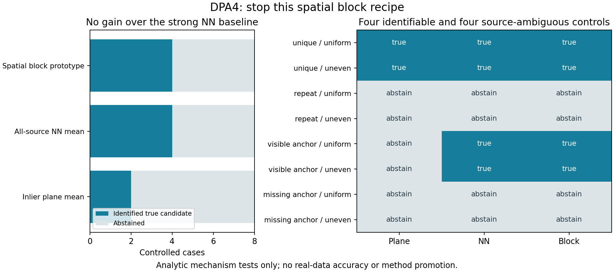

# DPA4受控结构试验与停止决策

2026-11-10，Asia/Shanghai。用户授权继续决策与执行、更新交接并一次提交和推送。本阶段实际执行完成；研究 **UNRESOLVED**，论文 **PAUSED**，没有真实数据准确率或新方法晋升。

## 决策

**停止本次空间分块支持配方，不进入真实数据扩展。** 8个固定受控例中，空间分块原型与普通最近点全源均距基线均为4例正确区分、4例弃权、0错误/歧义强判；没有强几何以上的新增可辨识例。点到面内点均值只有2例正确区分、6例弃权，原型多出的2例只是击败较弱基线，不能当创新或RAP增量。

完全重复和源锚点缺失的4例在全部主机制中均弃权，符合当前仅使用源可见几何的部分重叠合同。目标中的额外未观测结构不作负证据；反向统计没有用于选择。因此这里的“观测等价”限于规定的源可见证据，不是已建立传感器视锥/射线模型。

可见唯一锚点的2例中，别名候选仍匹配重复核心，其锚点距离超过.75m而被点到面内点支持丢弃，导致内点均值无法区分；普通全源NN已保留该证据并区分，分块没有新信息。不由此认证互惠/法线/谱安全，也不据控制结果调整真实阈值。

优化探索在此收束：DPA1–3发现局部目标锚定/结构身份局限，DPA4未给出强基线以上的新机制。不再换尺度、阈值、样本或重复构造救活此配方；后续科研需要不同且可独立验证的观测/结构证据。项目下一可执行重点为梳理和集成验收既有22份未提交工程修改，先交付可复核的工程基线，避免把机制负结果包装成科学进展。具体范围见NEXT_ENGINEERING_REVIEW.md，仅后续计划，本轮未改生产代码或开启训练。

## 实验与验证

输入为纯解析3正交面片、重复单元及可见/缺失锚点，8例、每例2固定候选。均匀与源y面重复采样形成密度不均对照，重复采样不增加独立物理点。真实变换、物理点ID及组别仅给事后评价器，几何scorer只读取a/b/na/nb/candidates，未读评价身份。候选顺序和点顺序seed311固定打乱。

生成8个输入共27,983字节；真实执行32次静态NN、墙钟0.445秒、峰值RSS约61.4MiB、结果65,017字节。0KITTI/raw/真实NPZ读取、RAP/ICP/训练/优化更新/生产改动。CPU单线程/CUDA不可见，AS≤2GiB−64MiB、CPU25秒/墙钟30秒、输出≤4MiB。

9项合成预检、4类资源负例、独立96项分数、32组保存距离、28组Gram谱及8例物理身份核查通过。独立核查不追加NN；最近点实现只在合成小例与穷举距离核对。无意外运行失败，预期预算负例保留。所有生成器、打分器、评价器、输入和规则在真实执行前冻结，未调参或补例。

## 全部选择结果

主选择均只用前向源可见几何；None为稳定带内无法区分/弃权。数值带不是安全接纳门槛。

| 例 | 结构/密度 | 预期 | 真候选索引 | 点到面 | NN强基线 | 分块 |
| --- | --- | --- | ---: | --- | --- | --- |
| case00 | unique / uniform | identify | 0 | identified_correct | identified_correct | identified_correct |
| case01 | unique / uneven | identify | 1 | identified_correct | identified_correct | identified_correct |
| case02 | repeat / uniform | ambiguous | 0 | abstained | abstained | abstained |
| case03 | repeat / uneven | ambiguous | 0 | abstained | abstained | abstained |
| case04 | visible_anchor / uniform | identify | 0 | abstained | identified_correct | identified_correct |
| case05 | visible_anchor / uneven | identify | 0 | abstained | identified_correct | identified_correct |
| case06 | missing_anchor / uniform | ambiguous | 1 | abstained | abstained | abstained |
| case07 | missing_anchor / uneven | ambiguous | 0 | abstained | abstained | abstained |

## 全部前向原始分数

完整双向32组记录见SCORES.csv和results/RESULTS.json；下表保留全部16个候选前向分数与支持，不删掉锚点缺失或密度变体。单位NN为m、Huber为m²，分块为无量纲，不跨指标比较绝对值。

| 例 | 候选 | NN均距 | 内点Huber均值 | 分块 | 内点/源数 | 互惠 |
| --- | ---: | ---: | --- | ---: | --- | ---: |
| case00 | 0 | 8.362318744e-17 | 1.112759523e-33 | 3.460638705e-16 | 108/108 | 108 |
| case00 | 1 | 7.501406451 | null | 0.6748677249 | 0/108 | 0 |
| case01 | 0 | 7.503013824 | null | 0.7665960024 | 0/252 | 0 |
| case01 | 1 | 8.735189084e-17 | 2.237747173e-33 | 3.634006266e-16 | 252/252 | 108 |
| case02 | 0 | 8.362318744e-17 | 1.112759523e-33 | 3.460638705e-16 | 108/108 | 108 |
| case02 | 1 | 3.974792852e-17 | 8.559688642e-35 | 1.251275916e-16 | 108/108 | 108 |
| case03 | 0 | 8.735189084e-17 | 2.237747173e-33 | 3.634006266e-16 | 252/252 | 108 |
| case03 | 1 | 4.16063085e-17 | 3.668437989e-35 | 1.193716247e-16 | 252/252 | 108 |
| case04 | 0 | 1.738341985e-16 | 1.088397333e-32 | 1.037139604e-15 | 156/156 | 156 |
| case04 | 1 | 1.211048288 | 8.559688642e-35 | 0.371875 | 108/156 | 108 |
| case05 | 0 | 1.336650241e-16 | 7.138780327e-33 | 1.047541658e-15 | 300/300 | 156 |
| case05 | 1 | 0.6297451097 | 3.668437989e-35 | 0.371875 | 252/300 | 108 |
| case06 | 0 | 3.974792852e-17 | 8.559688642e-35 | 1.251275916e-16 | 108/108 | 108 |
| case06 | 1 | 8.362318744e-17 | 1.112759523e-33 | 3.460638705e-16 | 108/108 | 108 |
| case07 | 0 | 8.735189084e-17 | 2.237747173e-33 | 3.634006266e-16 | 252/252 | 108 |
| case07 | 1 | 4.16063085e-17 | 3.668437989e-35 | 1.193716247e-16 | 252/252 | 108 |

## 交接、保全与发布范围

原8入口先备份，22生产文件原字节保持，DPA1–3及9旧seal/115登记核验不改。真实来源/处理版本/物理参考未知、训练未准入、03开发暴露、SSC1/PGC1停止/七份部分准确率未解释读取、official MAC未运行保持。纯解析控制不是训练包，不修复真实来源缺口。

本轮仅一次聚焦RAP-main提交本目录和docs/experiments/DPA4.md；已有生产修改与聚合导航继续保留未提交，提交中after/存日期快照。推送指定origin/chore/autodl-history-20261107，初始远端12f72996…，快进包含此前DPA2和DPA3已提交历史及本轮提交，不强推、不修改另一仓库远端。提交/推送实际hash收据在阶段外保存，避免第二次提交自引用。

主入口HANDOFF_CN.md；计算/预检/评价脚本、独立结果、所有源输入、冻结/监督收据及SCORES.csv均在本目录。CLOSEOUT_CHECKS记录科学/生产保全，PRECOMMIT_CHECKS记录提交审阅，ARTIFACT_MANIFEST记录精确产物字节。原SVG字节保留，clean.svg只去行尾空格。
